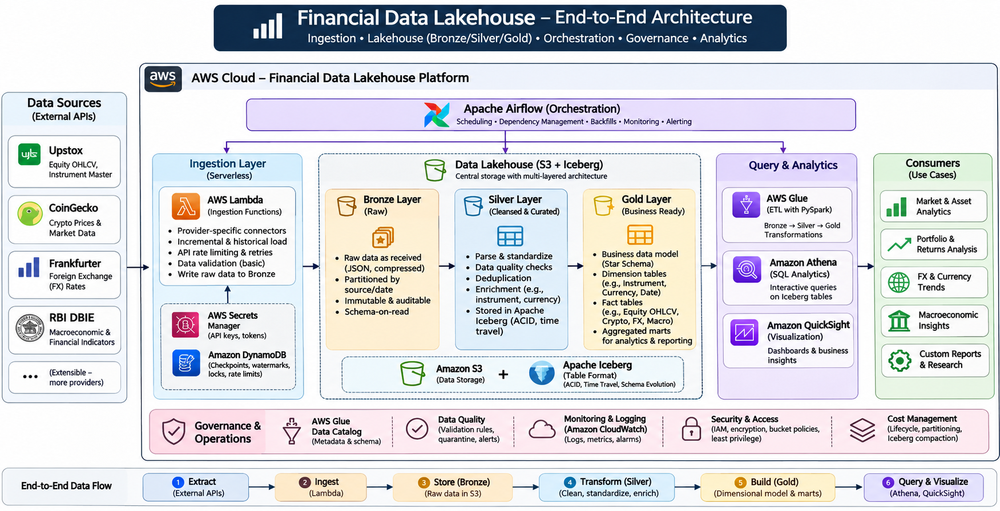
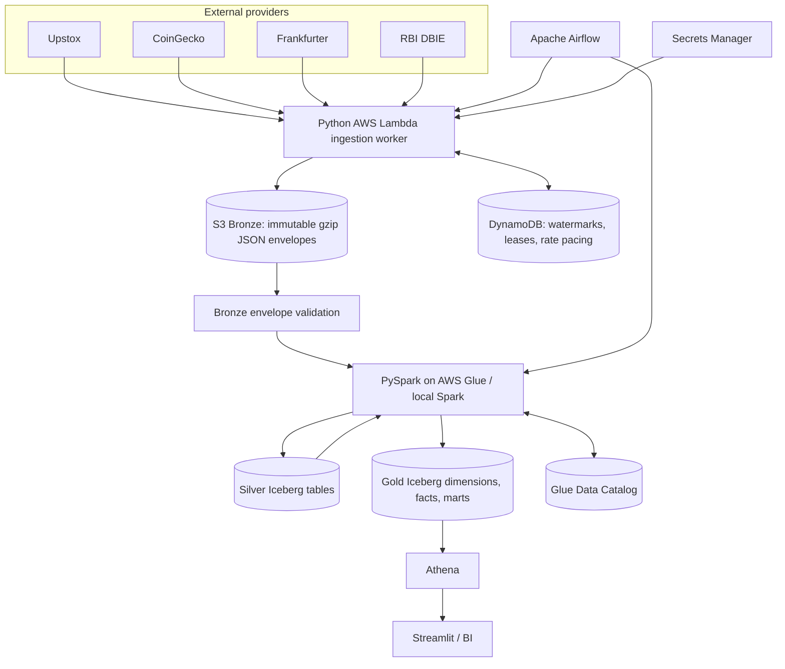

# Financial Data Lakehouse

A personal, AWS-first, multi-source financial data engineering platform. It ingests Indian equity candles, crypto market snapshots, FX rates and Indian macroeconomic observations, then publishes cleaned Silver Iceberg tables and dimensional Gold facts/marts.

The repository deliberately keeps **API ingestion**, **Spark transformations**, **orchestration**, and **infrastructure** separate. The same PySpark application code runs locally against Floci and in production on AWS Glue.


## 1. Scope and source contracts

| Provider | Entity | Grain in Silver | Extraction | Authentication |
|---|---|---|---|---|
| Upstox | `instrument_master` | instrument key + master snapshot date | Daily public BOD gzip JSON master | Public feed, no OAuth |
| Upstox | `equity_ohlcv` | instrument + exchange trading date + interval | Historical daily candles and incremental overlap | OAuth access token |
| CoinGecko | `market_snapshot` | coin + quote currency + snapshot date | Market snapshot | Optional Demo API key |
| Frankfurter | `daily_rates` | rate date + base + quote | Historical range / daily incremental | No key |
| RBI DBIE | `table_catalogue`, `table_metadata`, `table_rows` | table discovery rows, metadata hash, observation row hash/vintage | Catalogue discovery + per-table metadata + paginated observations | Public read API |

The daily Upstox BOD instrument master (`https://assets.upstox.com/market-quote/instruments/exchange/complete.json.gz`) is retained as Bronze and normalized into dated `upstox_instrument_master` Silver snapshots. The master refreshes around the start of the trading day; Upstox recommends `instrument_key` as the stable identifier. Gold `dim_instrument` uses the latest master metadata and reviewed reference enrichment.

RBI `table_catalogue` and `table_metadata` are retained in Bronze and normalized into `rbi_table_catalogue` and `rbi_table_metadata` Silver tables for discovery and audit. The weekly RBI DAG refreshes the catalogue and processes both metadata and observation rows before refreshing Gold. The sample RBI table name/filter in `events/rbi_rows_bootstrap.json` is illustrative; discover and validate an actual table through the live DBIE catalogue before configuring the weekly workflow.

**Data-use boundary:** this is a personal research/learning platform. Free developer access does not automatically grant redistribution or public display rights for exchange/market data. Review each provider's current terms before publishing data.

## 2. Architecture



### Runtime split

| Capability | Local development | AWS deployment |
|---|---|---|
| API ingestion | Floci Lambda | AWS Lambda |
| Raw storage | Floci S3 | Amazon S3 |
| Checkpoints / locks | Floci DynamoDB | DynamoDB |
| Secrets | Floci Secrets Manager | Secrets Manager |
| Glue Catalog | Floci Glue API | Glue Data Catalog |
| Spark execution | Local PySpark (`spark-submit`) | AWS Glue Spark |
| Table format | Apache Iceberg | Apache Iceberg |
| SQL | Floci Athena / DuckDB sidecar, subject to local Iceberg compatibility | Amazon Athena |
| IaC | `infra/template.yaml` through Floci CloudFormation | `infra/template.yaml` plus `infra/template.aws-glue.yaml` |

**Floci caveat:** Floci can emulate Glue Catalog and Glue job control-plane operations, but `StartJobRun` does not execute the Spark script. Run actual transformations with `scripts/run_local_spark.sh` locally. Use real AWS Glue jobs in AWS. See `docs/local_floci.md`.

## 3. Repository layout

```text
financial-lakehouse-ingestion/
├── config/reference/                 # reviewed instrument/currency/RBI mappings
├── dags (examples/airflow/)          # daily/weekly Airflow DAGs
├── docs/                             # Floci and data dictionary runbooks
├── events/                           # sample Lambda event payloads
├── glue_jobs/                        # AWS Glue entrypoints (thin wrappers)
├── infra/                            # Lambda stack and AWS-only Glue stack
├── lambda_src/                       # provider connectors and ingestion handler
├── lakehouse_src/lakehouse/           # shared validation, DQ, Spark application code
├── scripts/                          # local setup, packaging, deployment, execution
├── sql/analytics/                    # Athena-ready Gold queries
├── tests/                            # unit and optional local Spark tests
├── requirements-local.txt
└── requirements-airflow.txt
```

## 4. Storage layout and table format

The raw S3 bucket has these top-level prefixes:

```text
s3://<raw-bucket>/
├── bronze/<source>/<entity>/extract_date=YYYY-MM-DD/run_id=<id>/<entity-key>/part-*.json.gz
├── quarantine/<source>/run_id=<id>/             # row-level PySpark rejects (Parquet)
├── quarantine/bronze_validation/                # invalid-envelope object references (JSON)
├── audit/ingestion_runs/                        # Lambda extraction manifests
├── audit/bronze_validation/                     # Bronze validation manifests
├── audit/processing_runs/                       # Silver/Gold processing manifests
├── audit/table_maintenance/                     # Iceberg maintenance manifests
├── reference/                                   # version-controlled CSV reference inputs
└── warehouse/                                   # physical Iceberg table data + metadata
```

The logical databases are `lakehouse_silver` and `lakehouse_gold`. Iceberg's GlueCatalog warehouse creates managed table locations beneath `warehouse/<database>/<table>/`; Bronze remains immutable under `bronze/`. The logical database names are the layer boundary; physical Iceberg files use the common managed warehouse.

### Bronze envelope contract

Every Lambda object is a gzip-compressed JSON document:

```json
{
  "metadata": {
    "source": "upstox",
    "entity": "equity_ohlcv",
    "entity_key": "NSE_EQ|INE002A01018",
    "run_id": "run-001",
    "extract_date": "2026-10-30",
    "ingested_at": "2026-10-30T12:00:00Z",
    "request": {"url": "https://provider.example/api", "query": {}}
  },
  "response": {"provider": "original response body"}
}
```

Bronze is append-only and stores the provider response without flattening it. Processing metadata is in the envelope and S3 key; do not place API tokens in request metadata.

## 5. Processing layers

### Bronze

- Written by the Lambda ingestion framework.
- Immutable raw provider response snapshots, gzip JSON.
- Partitioned in the key by provider, entity, extract date and run ID.
- Validated by `lakehouse.bronze_validation` before transformation.
- Invalid envelope metadata/JSON is reported under `quarantine/bronze_validation/` and a validation audit is written.

### Silver

The Bronze-to-Silver Spark job reads only the chosen source/entity prefix, parses the provider envelope, flattens nested JSON and validates domain rules.

| Table | Primary grain | Dedupe/upsert key | Partition transform |
|---|---|---|---|
| `lakehouse_silver.upstox_instrument_master` | instrument key / master snapshot date | instrument key + master date | `months(master_date)` |
| `lakehouse_silver.equity_daily_ohlcv` | equity instrument / trading date / interval | instrument key + trading date + interval + source | `months(trading_date)` |
| `lakehouse_silver.crypto_market_snapshots` | coin / quote currency / snapshot date | crypto ID + currency + snapshot date | `months(snapshot_date)` |
| `lakehouse_silver.fx_daily_rates` | rate date / base / quote | rate date + base + quote + source | `months(rate_date)` |
| `lakehouse_silver.macro_observations` | RBI table row hash/vintage | schema + table + row hash | `months(extract_date)` |
| `lakehouse_silver.rbi_table_catalogue` | RBI catalogue item snapshot | source entity + row hash | `months(extract_date)` |
| `lakehouse_silver.rbi_table_metadata` | RBI table metadata version | schema + table + metadata hash | `months(extract_date)` |

Invalid equity, crypto and FX observations are written as Parquet in the source quarantine path. RBI rows that do not match a generic period/value alias are retained in Silver with `dq_status='REVIEW'` and copied to quarantine for manual mapping. Only RBI `VALID` rows reach Gold.

### Gold

Gold is built from complete Silver history in the initial version to make window metrics reproducible. All writes use Iceberg `MERGE` keyed on the table's business grain; repeating the job is idempotent. Facts use the dimension version effective on the observation date.

Dimensions:

- `dim_instrument` (SCD2, refreshed from the daily Upstox BOD instrument master; reviewed CSV fills sector and other curated attributes)
- `dim_crypto_asset` (SCD2)
- `dim_currency` (reference lookup)
- `dim_macro_indicator` (reviewed RBI mapping)
- `dim_date` (continuous calendar)
- `dim_data_source` (provider lookup)

Facts:

- `fact_equity_daily_ohlcv`
- `fact_crypto_market_snapshot`
- `fact_fx_daily_rates`
- `fact_macro_observation` (stores row hashes and vintages, so revisions are retained)

Marts:

- `mart_equity_returns`
- `mart_crypto_performance`
- `mart_fx_trends`
- `mart_macro_latest`
- `mart_asset_class_daily`

See `docs/data_dictionary.md` for grains, column meanings and metric definitions.

## 6. Local development on Floci

Use the instructions in [`docs/local_floci.md`](docs/local_floci.md). The short path is:

```bash
cp .env.floci.example .env.floci
source scripts/floci_env.sh
./scripts/deploy_local_floci.sh
source scripts/floci_env.sh
./scripts/local_init_floci.sh

python -m venv .venv
source .venv/bin/activate
pip install -r requirements-local.txt

# Populate local Upstox and CoinGecko Secrets Manager secrets first.
./scripts/run_local_pipeline.sh
```

`deploy_local_floci.sh` deploys the Lambda/API-ingestion stack only. `local_init_floci.sh` creates the Glue Catalog databases and uploads reference CSVs. `run_local_pipeline.sh` invokes the public Upstox instrument master, sample Upstox candles, CoinGecko, Frankfurter and RBI catalogue events, validates the corresponding Bronze prefixes, runs source-specific Silver jobs and publishes Gold. It deliberately does not execute the sample RBI table-row event because its schema/table/filter are illustrative and must be verified against the current DBIE catalogue first.

The RBI sample table/filter is illustrative. Discover the RBI catalogue, inspect a table's metadata and sample rows, then register its field mapping in `config/reference/macro_indicators.csv` before enabling `events/rbi_rows_bootstrap.json` or the weekly DAG.

## 7. Local step-by-step commands

```bash
# Invoke one extraction directly through Floci Lambda
aws lambda invoke --function-name <function-name> \
  --cli-binary-format raw-in-base64-out \
  --payload fileb://events/coingecko_daily.json /tmp/coingecko.json

# Validate all matching raw envelopes in Bronze
python scripts/validate_bronze.py --bucket "$RAW_BUCKET" --source coingecko --entity market_snapshot

# Normalize one provider/entity into Silver Iceberg
./scripts/run_local_spark.sh bronze-to-silver --source coingecko --entity market_snapshot

# Build all dimensions, facts and marts from Silver history
./scripts/run_local_spark.sh silver-to-gold

# Optional compaction/snapshot expiration (7-day minimum retention)
./scripts/run_local_spark.sh maintenance --snapshot-retention-days 30
```

The local Spark runner defaults to Spark 3.5.6, Iceberg 1.10.0, and Hadoop AWS 3.3.4. The Hadoop AWS version must match the Hadoop version bundled with your Spark distribution. Local Spark needs Java and Maven artifact access/cached dependencies.

## 8. AWS deployment

### 8.1 Deploy Lambda, S3, DynamoDB, IAM and secrets

Prerequisites: AWS CLI v2, AWS credentials, and an existing artifact bucket in the target AWS Region.

```bash
export AWS_REGION=ap-south-1
export ARTIFACT_BUCKET=<deployment-artifact-bucket>
./scripts/deploy.sh
```

This deploys `infra/template.yaml`, creating the private raw bucket, DynamoDB state table, Secrets Manager secrets, Lambda function, CloudWatch log group and Glue execution role. The AWS-only processing stack also creates Lambda error, throttle and high-duration CloudWatch alarms.

Set provider secrets using the CloudFormation outputs:

```bash
aws secretsmanager put-secret-value --secret-id <UpstoxTokenSecretArn> \
  --secret-string '{"access_token":"<TOKEN>","expires_at":"<EPOCH_MS_OR_ISO>"}' --region "$AWS_REGION"
aws secretsmanager put-secret-value --secret-id <CoinGeckoApiSecretArn> \
  --secret-string '{"api_key":"<COINGECKO_DEMO_KEY>"}' --region "$AWS_REGION"
```

Upstox token generation/refresh is a user-consent OAuth operation in this version. After generating the token, use `scripts/set_upstox_token.sh` to securely update the Secrets Manager secret without placing the token in a command-line argument. Tokens are not accepted in Lambda event payloads or written to Bronze.

### 8.2 Deploy actual AWS Glue jobs

```bash
export AWS_REGION=ap-south-1
export ARTIFACT_BUCKET=<same-region-artifact-bucket>
./scripts/deploy_glue.sh
```

This packages `lakehouse_src` into `dist/lakehouse-src.zip`, uploads the two Glue entrypoints and library to S3, syncs reviewed reference CSVs, and deploys `infra/template.aws-glue.yaml` with Bronze-to-Silver, Silver-to-Gold and Iceberg maintenance jobs. This AWS-only template creates actual `AWS::Glue::Database` and `AWS::Glue::Job` resources; do not deploy it to Floci.

Default production Glue version is 5.1 with G.1X workers. Adjust worker count and Glue version only after confirming the bundled Spark/Iceberg compatibility for your chosen runtime.

## 9. Airflow orchestration

Install `requirements-airflow.txt` into your Airflow environment (and use a compatible Airflow core version). Configure Airflow Variables:

| Variable | Meaning |
|---|---|
| `FINANCIAL_INGESTION_FUNCTION_NAME` | Lambda function name from CloudFormation |
| `FINANCIAL_RAW_BUCKET` | Raw/lakehouse bucket name |
| `FINANCIAL_GLUE_B2S_JOB` | Bronze-to-Silver job name |
| `FINANCIAL_GLUE_S2G_JOB` | Silver-to-Gold job name |
| `FINANCIAL_GLUE_MAINTENANCE_JOB` | Iceberg maintenance job name |
| `FINANCIAL_AWS_REGION` | Region containing Lambda, S3 and Glue resources |
| `FINANCIAL_UPSTOX_INSTRUMENT_KEYS` | Comma-separated stable instrument keys |
| `FINANCIAL_UPSTOX_BOOTSTRAP_START_DATE` | Initial Upstox date used only while no checkpoint exists (default `2020-01-01`) |
| `FINANCIAL_FX_BOOTSTRAP_START_DATE` | Initial Frankfurter date used only while no checkpoint exists (default `2020-01-01`) |
| `FINANCIAL_RBI_BOOTSTRAP_START_DATE` | Initial RBI observation date used only while no checkpoint exists (default `2010-01-01`) |
| `FINANCIAL_RBI_SCHEMA` / `FINANCIAL_RBI_TABLE` | Reviewed DBIE table identifier |

Use `examples/airflow/daily_financial_lakehouse.py` for daily Upstox/CoinGecko/FX ingestion and Bronze-to-Silver/Gold processing. It runs every day for crypto/FX; the Upstox payload selects the latest completed weekday and includes an overlap window. Each Spark job is scoped to that run's `extract_date`, so the daily DAG does not rescan all Bronze history. `examples/airflow/weekly_rbi_lakehouse.py` refreshes the catalogue, ingests one reviewed RBI table (which also captures its metadata), normalizes catalogue/metadata/rows, then refreshes Gold. Historical backfills use a shared deterministic run ID between Lambda and Spark, and do not advance watermarks by default. CoinGecko `/coins/markets` is a current-snapshot endpoint; historical replay is supported from existing Bronze snapshots, not by requesting arbitrary historical dates from that endpoint.

The Airflow role needs `lambda:InvokeFunction` on the ingestion function and `glue:StartJobRun`, `glue:GetJobRun`, `glue:GetJobRuns` on the processing jobs. It does not need to read secrets because the Lambda execution role owns provider credentials. Configure source-specific Airflow pools and keep Lambda reserved concurrency conservative.

## 10. Testing and quality

```bash
python -m compileall -q lambda_src lakehouse_src glue_jobs scripts examples tests
python -m unittest discover -s tests -v
```

The unit suite mocks provider/AWS interactions and tests envelope validation and pure quality rules. The GitHub Actions `spark-transform-tests` job installs PySpark 3.5.6 and runs the Spark transformation suite. An actual Floci integration test requires Floci running; an Iceberg catalog/S3 integration test requires local Spark jars and should be run in your development environment. A successful Floci Glue `StartJobRun` response is not a successful Spark transformation.

### Data-quality guarantees

- OHLCV: positive OHLC values, high >= all OHLC, low <= all OHLC, non-negative volume.
- Crypto: ID/currency/date present and current price non-negative.
- FX: date/base/quote present and exchange rate > 0.
- RBI: explicit `VALID`/`REVIEW` state; table-specific field mapping required before Gold promotion.
- Bronze: gzip/JSON validity, metadata fields, source/entity path consistency and supported entity tuple.

## 11. Operational behaviour

- Lambda runs one bounded extraction unit per invocation. Historical backfills are split by instrument/date range/table and orchestrated by Airflow.
- DynamoDB stores source-scoped watermarks, invocation leases and shared per-provider request pacing. Recurring DAG events may include `bootstrap_start_date`; it is consumed only when no successful watermark exists, then the regular overlap-based incremental range takes over. Retries respect HTTP retry delays and the shared pacer.
- Silver/Gold jobs merge on deterministic business keys; reprocessing does not append duplicates.
- Historical price corrections are re-read through the overlap window and updated by Iceberg MERGE.
- RBI macro revisions are retained as distinct row-hash/vintage observations.
- Gold moving averages/volatility currently recompute from the full Silver history. This is appropriate for the starter portfolio scale; for larger data volumes, implement affected-partition recompute and persist a bounded rolling state.
- Iceberg snapshot expiration has a 7-day minimum in the maintenance job. Increase retention if you need longer time-travel/recovery windows. Snapshot expiration is destructive to old snapshot metadata.
- There is no Kafka/streaming implementation in this release; daily batch ingestion is the foundation.

## 12. Cost controls

- Avoid always-on MWAA during development; run Airflow locally or on a small existing host.
- Glue jobs are on-demand. Start with 2 G.1X workers and measure before increasing.
- Compress Bronze JSON and query Parquet/Iceberg tables rather than raw payloads.
- Partition facts by month for daily granularity; avoid per-symbol partitions.
- Set CloudWatch retention and Athena workgroup scan limits.
- Maintain a 7-day or longer Iceberg snapshot policy; avoid frequent compaction on small tables.

## 13. Known boundaries / next enhancements

1. Upstox OAuth token refresh remains a user-consent operation; use the documented authorization process and update Secrets Manager. The public BOD instrument master is ingested automatically.
2. RBI generic aliases are not guaranteed to cover every DBIE table. Review the API schema and add exact mapping rows before a table is promoted to Gold.
3. The BOD instrument master is retained as dated Silver snapshots; `config/reference/instruments.csv` remains the reviewed override/enrichment source for attributes such as sector. Historical metadata before the first collected BOD snapshot is not retrospectively known.
4. The first Gold build is full-history and batch-oriented. Streaming/intraday processing, Kinesis and Structured Streaming are later phases.
5. The framework does not perform trades or offer investment advice.

## 14. Official documentation

- Floci: https://github.com/raindancers/floci
- Floci Glue: https://floci.dev/docs/services/glue
- Floci Athena: https://floci.dev/docs/services/athena
- Upstox API: https://upstox.com/developer/api-documentation/
- CoinGecko API: https://docs.coingecko.com/
- Frankfurter: https://frankfurter.dev/
- RBI DBIE: https://dev.dbie.rbihub.in/docs/using-the-site
- AWS Glue Iceberg: https://docs.aws.amazon.com/glue/latest/dg/aws-glue-programming-etl-format-iceberg.html
- Apache Iceberg Spark: https://iceberg.apache.org/docs/latest/spark-writes/
- AWS Athena Iceberg: https://docs.aws.amazon.com/athena/latest/ug/querying-iceberg.html
